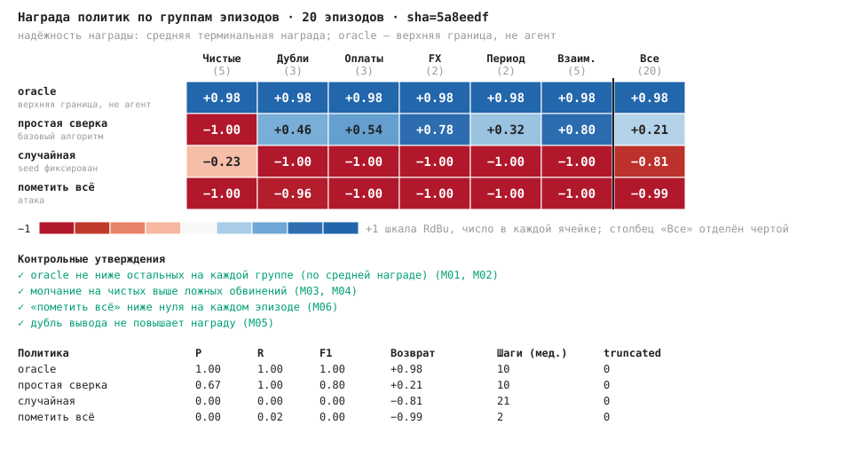
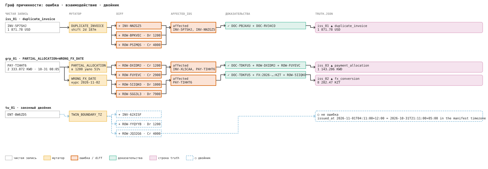
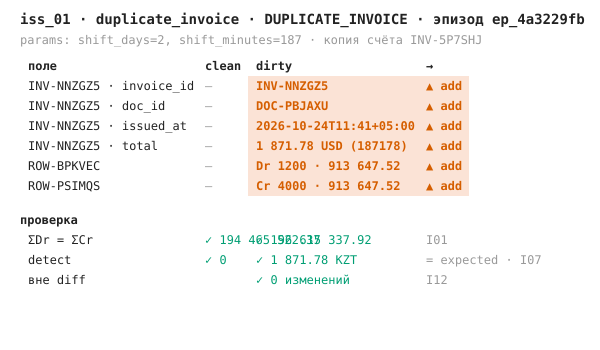

# genesis-fin-env — RL-среда для дообучения ИИ-аудиторов

Воспроизводимый симулятор: синтетические документы компании, инструменты расследования, скрытые финансовые
ошибки с записанной причиной и функция награды. Среда **не обучает** модель; она даёт интерфейс для RL,
траектории и оценку качества. Python 3.11, только стандартная библиотека (pytest — только для тестов), без сети и GPU.
Все компании, люди, счета и суммы вымышлены.

## Запуск

```powershell
make check            # или: python scripts/check.py        (тесты → эпизоды → траектории → аудит → viz)
python scripts/check.py --fast   # то же, но C18 ждёт 2 с вместо 61 с
docker build -t fin-env . ; docker run --rm --network none fin-env
```

Отдельные команды (`PYTHONPATH=src`):

| Что | Команда |
| --- | --- |
| один эпизод с самопроверкой I01–I17 | `python -m fin_env.generate --seed 4217 --config configs/example_duplicate.json --out episodes/x` (конфиг: `errors` / `interactions` / `twins`; 6 типов ошибок, 2 взаимодействия, 7 двойников) |
| открытые train/dev (10+10) | `python -m fin_env.splits` |
| 4 базовые политики → `trajectories.jsonl` | `python -m fin_env.baselines` |
| самоаудит 80 проверок | `python -m audit [--fast] [--inject-bug leak\|dup\|order]` → `reports/audit.json`, `reports/audit.md` |
| визуалы | `python -m viz --episodes episodes/train episodes/dev --audit reports/audit.json --out reports/viz` |
| 1000 seed | `python -m fin_env.stress --n 1000` |

## Контракт среды

```python
from fin_env.env import FinAuditEnv
env = FinAuditEnv()                                   # оценщик — отдельный процесс (evaluator_mode="inproc" — для массовых прогонов)
obs, info = env.reset(None, {"episode_dir": "episodes/dev/ep_xxx", "mode": "open"})   # mode: open | closed
obs, reward, terminated, truncated, info = env.step({"action": "list_records", "table": "ledger", "cursor": None, "limit": 50})
```

* `reset(seed, config)`: `config` = `{episode_dir | episodes_dir+episode_id | gen_config (+seed)}`, `mode`, `time_limit_s`.
  Первое наблюдение: `task`, `manifest`, `policy`, `steps_left=100` — без seed и truth.
* Действия (`{"action": имя, ...}`, также `args`/`arguments`): `list_records(table, cursor, limit)` (страница ≤ 50,
  `limit>50` → `BAD_ARGS`), `get_record(table, id)`, `get_document(doc_id)`, `calculator(expression)`
  (десятичная арифметика `+ - * / ( )`), `submit(findings)`. Таблицы: `ledger`, `invoices`, `payments`, `fx` (ключ `FX:<date>:<src>:<tgt>`).
* Ошибки: `UNKNOWN_ID`, `BAD_ACTION`, `BAD_ARGS`, `CALC_ERROR`, `EPISODE_DONE` — шаг списан, без traceback.
* Завершение: `submit` → `terminated=True`; 100 шагов (в т.ч. submit) или 60 с → `truncated=True` и пустой ответ.
* Награда: `clip(2·F1 − 1 − 0.002·inspection_steps, −1, 1)`; `submit` не входит в `inspection_steps`.
  `closed`: все награды 0, `info == {"steps_left": n}`, оценка доступна харнессу после конца (`env.evaluation_result()`).
* JSON-lines драйвер: `python -m fin_env.server`.
* Адаптер жюри `judge_adapter.py`: `generate_episode(seed, config, output_dir)` (output_dir становится episode_dir),
  `make_env()`, `score_episode(episode_dir, findings, inspection_steps)`. `reset(..., {"mode": "closed", "episode_dir": ...})`
  загружает эпизод, `mode="train"` генерирует открытый эпизод из seed + `team_config`. `submit` отвечает `{"accepted": true}`;
  структурно неверный ответ — `BAD_ARGS`, награда −1, метрики `null`. `affected_ids` сравниваются как множество.

Формат вывода: `{type, affected_ids, claimed_amount_minor, currency, evidence_ids, explanation}`; правила сумм и валют
для каждого типа — в `policy.claims` первого наблюдения. Матчинг и награда: `src/fin_env/matcher.py`, `reward.py`.

## Честный ответ получает ≈ +0.98, атака «пометить всё» — минус



*Награда политик по группам эпизодов (20 эпизодов самоаудита). Числа получены прогоном; oracle — верхняя граница награды, а не агент.
Воспроизведение: `python -m audit && python -m viz`.* Таблица: [reports/viz/policy_matrix.md](reports/viz/policy_matrix.md).

## Как устроен эталон

Каждая строка `truth.json` выведена из записанной мутации (`MutationRecord`), а у каждой ловушки есть один признак,
отличающий её от ошибки (`distinguishing_feature`). Граф причинности (Mermaid, топ-3 цепочки; остальное в `reports/viz/causal/`):

[reports/viz/causal/README_top3.md](reports/viz/causal/README_top3.md) · SVG: 

Diff-карточка (до/после, баланс и независимый пересчёт):  · все карточки: `reports/viz/diff/`.

Самоаудит: `reports/audit.md` — **ожидаемая** оценка по нашей трактовке критериев, не официальная.

## Структура

`src/fin_env` (генератор A: `books/`, `mutations/`; самопроверка B: `selfcheck/`; среда, matcher, оценщик, политики) ·
`src/audit` (модуль C) · `src/viz` · `configs/` (audit_suite D01–D20, train/dev) · `episodes/{train,dev}/<id>/{public,sealed}` ·
`tests/` · `DESIGN.md` (решения, ограничения, измеренный сбой).

Лицензия MIT. Зависимости: см. `requirements.lock`.
